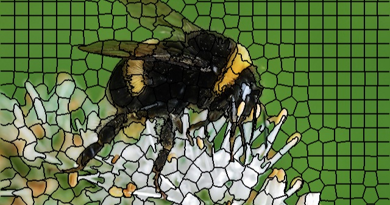
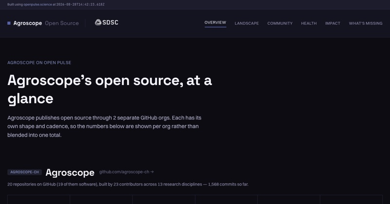
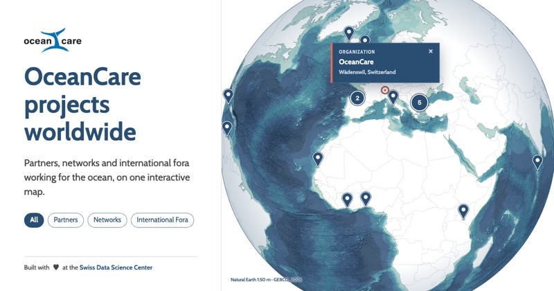
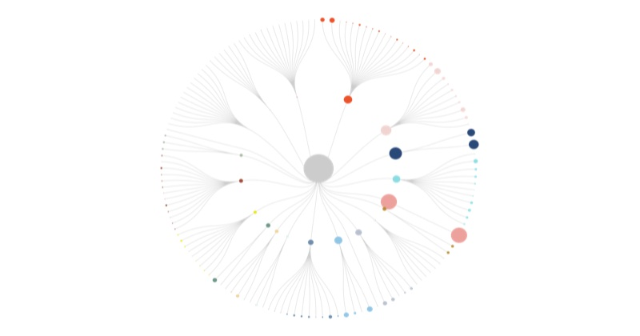
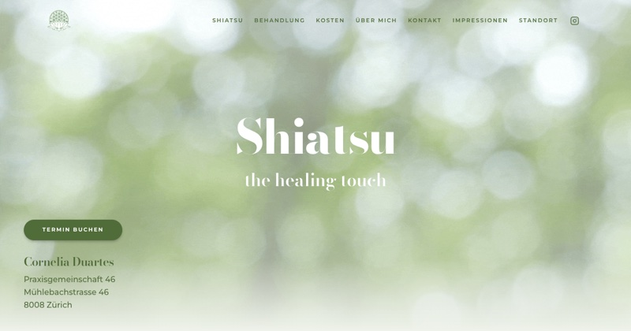
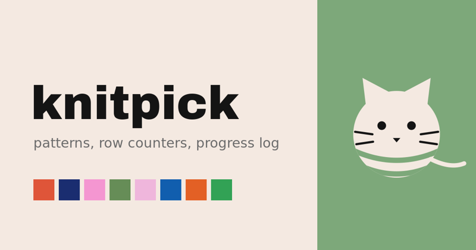

  
  
  
  
  
  
  

**digital humanities × design × code**

Hi, I'm Hannah! I'm a **frontend research engineer** at the
[Swiss Data Science Center](https://datascience.ch), based in **Zurich**.

I care about **thoughtful design**, making **complex data readable**, and making
**cultural archives accessible**.

At SDSC I build **interfaces for research projects and tools**. I enjoy working across many
fields, from **biomedical research to ecology**, and I take part in projects
**from initial design to implementation**, working in iterations.

I love spending time away from screens, working as an **extra at the opera** and making **fiber arts**.

### Projects

#### At SDSC

<table>
  <tr>
    <td width="50%" valign="top">
      
      <h3><a href="https://imaging-plaza.epfl.ch">Imaging Plaza</a></h3>
      A catalogue that helps researchers find the right software for their image analysis task,
      built with the EPFL Center for Imaging.
        
      <code>TypeScript</code> <code>React</code> <code>SCSS</code>
      &nbsp;·&nbsp; <a href="https://github.com/sdsc-ordes/imaging-plaza-webapp">repo</a>
    </td>
    <td width="50%" valign="top">
      
      <h3><a href="https://nds-lucid-web-app.vercel.app">LUCID</a></h3>
      The website of LUCID, a project on quality of care in Swiss university hospitals:
      a national data stream, low-value care, and patient-reported outcomes and experiences.
        
      <code>SvelteKit</code> <code>Svelte 5</code> <code>TypeScript</code> <code>Tailwind</code>
      &nbsp;·&nbsp; <a href="https://github.com/sdsc-ordes/nds-lucid-web-app">repo</a>
    </td>
  </tr>
  <tr>
    <td width="50%" valign="top">
      
      <h3><a href="https://github.com/sdsc-ordes/open-pulse-webkit">Open Pulse WebKit</a></h3>
      A starter kit for non-experts to build interactive dashboards on
      <a href="https://openpulse.science">Open Pulse</a> research-software data.
        
      <code>TypeScript</code> <code>Claude Code skills</code> <code>design system</code>
    </td>
    <td width="50%" valign="top">
      
      <h3><a href="https://sdsc-ordes.github.io/compass/">Compass</a></h3>
      An interactive map of ocean-focused research institutes, NGOs and international bodies,
      built on a SHACL-validated RDF ontology. First deployed for
      <a href="https://www.oceancare.org">OceanCare</a>.
        
      <code>Svelte</code> <code>d3-geo</code> <code>FastAPI</code> <code>RDF/SHACL</code>
      &nbsp;·&nbsp; <a href="https://github.com/sdsc-ordes/compass">repo</a>
    </td>
  </tr>
</table>

#### Research

<table>
  <tr>
    <td width="50%" valign="top">
      
      <h3><a href="https://infoscience.epfl.ch/entities/publication/2a587669-b381-4934-b9ff-e778d04afb06">Mapping Bibliotheca Hertziana</a></h3>
      My EPFL master's thesis: a map of a century-old art history library built from its loan data,
      using dimensionality reduction and LLM-assisted cluster descriptions.
        
      <code>Python</code> <code>Jupyter</code> <code>data visualisation</code>
      &nbsp;·&nbsp; <a href="https://infoscience.epfl.ch/entities/publication/2a587669-b381-4934-b9ff-e778d04afb06">publication</a>
      &nbsp;·&nbsp; <a href="https://github.com/hanaCasey/BHVizData">repo</a>
    </td>
  </tr>
</table>

#### Personal

<table>
  <tr>
    <td width="50%" valign="top">
      
      <h3><a href="https://www.stadelhofen-shiatsu.ch">Shiatsu Stadelhofen</a></h3>
      A website for a shiatsu practice at Zurich Stadelhofen.
        
      <code>React</code> <code>Vite</code> <code>TypeScript</code> <code>Tailwind</code>
    </td>
    <td width="50%" valign="top">
      
      <h3><a href="https://github.com/hanaCasey/knitpick">knitpick</a></h3>
      A local-first knitting companion with pattern PDFs, linked row counters and a progress log.
      No server, no accounts, works offline.
        
      <code>SvelteKit</code> <code>Svelte 5</code> <code>TypeScript</code> <code>Dexie</code>
    </td>
  </tr>
</table>
